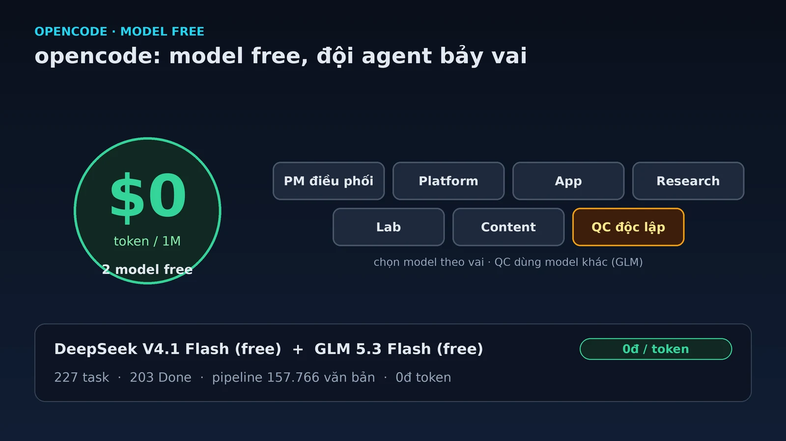

Với coding agent, rào cản lớn nhất thường không phải năng lực của model, mà là hóa đơn. Một phiên làm việc dài có thể ngốn vài đô tiền token, và khi bạn muốn chạy nhiều agent song song thì con số đó nhân lên rất nhanh.

opencode gần đây thay đổi đúng điểm đau đó: nó cho dùng **miễn phí** hai model — **DeepSeek V4.1 Flash** và **GLM 5.3 Flash**. Trong bài này tôi sẽ đưa bảng giá thực tế, cách tự kiểm chỉ bằng một lệnh, và quan trọng hơn: cách tôi đang vận hành **một đội agent bảy vai** trên opencode với **chi phí 0đ**.

<!-- truncate -->

## 1. opencode là gì, trong một đoạn

opencode là một coding agent chạy được ở CLI, TUI, web và desktop. Nó không tự huấn luyện model mà đóng vai lớp điều phối: hỗ trợ **75+ LLM provider**, quản lý **agent/subagent**, MCP server, skills, permissions và formatter. Một điểm đáng chú ý là **variant**: cùng một model nhưng chạy ở mức `low` / `high` / `max` để đổi giữa tốc độ và "độ suy nghĩ".

Cách gọi model trong opencode theo dạng `provider_id/model_id`, ví dụ `opencode/glm-5.3-flash-free`. Với ai đang dùng Claude Code, Codex hay Cursor, opencode là lựa chọn cùng loại nhưng mở hơn ở khoản chọn provider và model.

## 2. Bảng giá: cùng một model, nhiều mức giá

Điều đầu tiên cần hiểu: **cùng một model có thể xuất hiện ở nhiều provider với giá khác nhau**. Bảng dưới lấy từ danh sách model của opencode trên máy tôi, ngày 17/10/2026 (đơn vị: USD / 1 triệu token).

| Model | Vào | Ra | Biến thể |
|---|---:|---:|---|
| `opencode/deepseek-v4.1-flash-free` (**free**) | **0** | **0** | low · high · max |
| `opencode/glm-5.3-flash-free` (**free**) | **0** | **0** | low · high · max |
| `opencode/deepseek-v4.1-flash` (trả phí) | 0,30 | 1,20 | low · high · max |
| `opencode-go/deepseek-v4.1-flash` | 0,15 | 0,60 | low · high · max |
| `opencode/glm-5.3-flash` | 0,15 | 0,50 | low · high · max |
| `opencode-go/glm-5.3-flash` | 0,15 | 0,50 | low · high · max |
| Tham chiếu: `openrouter/z-ai/glm-5.3-flash` | 0,0341 | 0,4182 | — |
| Tham chiếu: gói `z.ai coding plan` | 0 | 0 | theo gói |

Hai điều rút ra. Thứ nhất, bản `-free` có giá **0/0** — không phải "rẻ", mà đúng nghĩa miễn phí token. Thứ hai, ngay cả khi phải trả tiền, **cache đọc** rẻ hơn nhiều lần so với token vào (ví dụ bản `opencode-go` có giá vào 0,15 nhưng cache đọc chỉ 0,003), nên các agent chạy vòng lặp đọc lại ngữ cảnh không tốn nhiều như cảm giác.

## 3. Tin mới: hai model free, tự kiểm bằng một lệnh

Hai model miễn phí mới là **DeepSeek V4.1 Flash** và **GLM 5.3 Flash**. Cách ghi nguồn ở đây cần rõ ràng: đây là thông tin từ **thông báo gần đây của opencode** (người dùng chuyển lại), và tôi **xác nhận trực tiếp bằng CLI** thay vì chỉ tin lời.

Cách kiểm nằm gọn trong một lệnh — chạy ngay trên máy bạn:

```bash
opencode models | grep -E "flash-free"
# opencode/deepseek-v4.1-flash-free
# opencode/glm-5.3-flash-free
```

CLI liệt kê **đúng tên** hai model này trong danh sách của opencode. Đây là cách kiểm nhanh, không phụ thuộc vào một trang thông báo có thể đổi địa chỉ. Chọn model rồi thêm hậu tố biến thể để đổi mức suy nghĩ, ví dụ chạy ở mức cao nhất:

```text
opencode/glm-5.3-flash-free#max
```

Phần `#max` là variant mạnh nhất của model đó. Với các tác vụ cần suy luận nhiều, đây là lựa chọn tôi dùng cho vai kiểm định chất lượng bên dưới.

## 4. Use case thật: một đội agent bảy vai, 0đ

Thay vì một agent làm tất cả, tôi chia việc thành **một đội bảy phiên**, mỗi phiên một vai, phối hợp qua một bảng công việc chung. Đây là mô hình "Option B" tôi đang chạy.

```text
                    ┌──────────── Bảng công việc chung ────────────┐
                    │            (task · trạng thái)                │
                    └───────▲───────────────┬───────────────▲──────┘
                            │               │               │
        ┌───────────────────┴──┐   ┌────────┴───────┐  ┌────┴───────────────┐
        │  PM điều phối        │   │  5 vai build   │  │  QC độc lập        │
        │  (loop 15'/1h)       │──▶│  Platform · App│─▶│  verdict PASS/FAIL │
        │  DeepSeek V4.1 Flash │   │  Research · Lab│  │  GLM 5.3 Flash Free│
        └──────────────────────┘   │  Content       │  │  (#max, model khác)│
                                   └────────────────┘  └────────────────────┘
```

Điểm đáng chú ý: **chọn model theo vai**, không dùng một model cho tất cả.

| Vai | Model | Việc chính |
|---|---|---|
| PM điều phối | DeepSeek V4.1 Flash | Ưu tiên hóa, giao việc, nghiệm thu; loop 15 phút (giờ thấp điểm) / 1 giờ (giờ cao điểm) |
| Platform/Data Engineer | DeepSeek V4.1 Flash | Corpus (VBPL · arXiv · Lịch sử), KB, backup/ops |
| Product/App Engineer | DeepSeek V4.1 Flash | KB Chat, UI/UX, wrapper OpenAI-compatible |
| Discovery & Research | DeepSeek V4.1 Flash | Khảo sát nguồn/công nghệ, xác minh đa nguồn (read-only) |
| Prototyping Lab | DeepSeek V4.1 Flash | PoC, benchmark, spike |
| Content & Docs | DeepSeek V4.1 Flash | Blog, docs, release notes |
| **QC độc lập** | **GLM 5.3 Flash Free `#max`** | Nghiệm thu độc lập, verdict PASS / PASS-điều kiện / FAIL |

Sau khoảng **hai ngày** vận hành, bảng có **227 task**: **203 Done**, 19 Cancelled, 4 còn mở. Vài kết quả cụ thể để thấy quy mô:

- **Pipeline citation VBPL**: xử lý **157.766 văn bản**, **106.616 tên file**, đối chiếu **88.210 + 73.956 dòng file** ở các định dạng `pdf/doc/docx/xls/zip/png`, tốc độ khoảng **1,4 giây/văn bản**, chạy nền bằng **systemd** và tự resume sau khi dừng.
- **Một sự cố thật**: API gateway của nguồn dữ liệu sập **503 trong ~16,5 giờ**. Job **tự chờ và thử lại 10 phút một lần**, không mất dữ liệu khi nguồn trở lại; vai QC tự phát hiện outage và chờ hồi phục thay vì báo lỗi giả.
- **QC độc lập**: mỗi task được chấm verdict `PASS / PASS-điều kiện / FAIL`, tái lập số liệu bằng truy vấn **read-only**, kiểm URL bằng `HEAD`, và **mở trình duyệt thật** để kiểm giao diện. Có task được xác nhận PASS vì số liệu **khớp chính xác từng con**, và kết luận "lỗi nằm ở nguồn chứ pipeline không đánh rơi dữ liệu".

Tổng chi phí token cho toàn bộ đội: **0đ** — vì PM và năm vai chạy bản model free, còn QC chạy một model free khác. Hạ tầng là máy local (SQLite cho corpus, UI chat chạy local, GPU RTX 2060), nên chi phí thật chỉ còn tiền điện và Internet.

## 5. Bốn bài học

**Chọn model theo vai.** Không phải vai nào cũng cần model mạnh nhất. Việc đọc tài liệu, tổng hợp, hay chạy vòng lặp kiểm tra đều nằm gọn trong một model Flash; chỉ những quyết định khó mới cần mức `#max`.

**QC phải dùng model khác.** Nếu người viết và người chấm cùng một model, họ **chia sẻ cùng điểm mù** và rất dễ "chấm điểm cho chính mình". Tôi cố ý để vai QC chạy GLM 5.3 Flash trong khi phần còn lại chạy DeepSeek V4.1 Flash — khác model, và vẫn 0đ vì cả hai đều có bản free.

**Quản chi phí là quản nhịp và ngữ cảnh, không phải chọn model rẻ.** Như [bài trước về loop engineering](/loop-engineering-agent-team) đã nói, chi phí tỉ lệ với số lần gọi nhân với kích thước ngữ cảnh. Việc cơ học (crawl, làm sạch, backup) nên chạy bằng script, **không gọi model**; chỉ việc cần phán đoán mới gọi LLM. Và việc nặng nên dồn vào giờ thấp điểm.

**Resilience quan trọng hơn tốc độ.** Job dài sẽ gặp mạng chập, API 503, tiến trình chết. Job phải **idempotent và resume-safe**, chạy dưới systemd và tự thử lại có kiểm soát. Sự cố 16,5 giờ không làm mất một dòng dữ liệu nào — đó là giá trị của thiết kế, không phải may mắn.

## 6. Hạn chế, nói thẳng

Model free không phải bản trả phí. Chúng **có thể bị rate-limit**, độ ổn định và độ trễ không đồng đều, và có lúc chậm hơn hẳn. Free phù hợp để **thử nghiệm, học, và các đội nhỏ chạy khối lượng vừa phải**; việc quan trọng hoặc cần độ ổn định cao thì nên dùng bản trả phí.

Chi phí 0đ cũng không hoàn toàn "miễn phí": bạn vẫn trả bằng **điện, Internet và phần cứng**, cộng thời gian vận hành. Số liệu 227 task ở trên là của **một máy local cụ thể**, không phải một benchmark chuẩn hóa — nên đọc nó như kinh nghiệm, không phải bảng xếp hạng.

Cuối cùng, đừng vì free mà bỏ qua chất lượng: nếu task thật sự khó, hãy cho nó một model đủ mạnh, hoặc thêm một vai kiểm định độc lập. Tiết kiệm token mà trả giá bằng kết quả sai thì đắt hơn nhiều.

## Kết

opencode đang rẻ theo hai nghĩa: bản trả phí đã rẻ hơn nhiều lựa chọn khác, và nay còn **hai model free** để bạn bắt đầu mà không cần thẻ tín dụng. Nhưng thứ quyết định thành công không phải giá model, mà là **cách chia vai, chọn model theo vai, và thiết kế để chạy bền**.

Nếu bạn muốn tự kiểm, chỉ cần một lệnh: `opencode models | grep flash-free`. Còn muốn hiểu cách tôi ghép đội và thiết kế vòng lặp, xem lại bài [loop engineering](/loop-engineering-agent-team).

## Tài liệu tham khảo

1. [opencode — Models](https://opencode.ai/docs/models/) — 75+ provider, variant `low`/`high`/`max`, cấu hình model và cách chọn.
2. [opencode v2](https://opencode.ai/v2) — phiên bản v2.
3. `opencode models` — CLI liệt kê model trên máy; xác nhận `opencode/deepseek-v4.1-flash-free` và `opencode/glm-5.3-flash-free` (kiểm ngày 17/10/2026).
4. [Loop engineering: vận hành một đội agent làm hơn 100 việc](/loop-engineering-agent-team) — bài trước về thiết kế vòng lặp và chi phí token.

*Giá trong bài là giá tại thời điểm 17/10/2026 và có thể thay đổi. Thông tin về hai model free được ghi theo thông báo gần đây của opencode (người dùng cung cấp) và xác nhận lại bằng CLI trên máy.*
