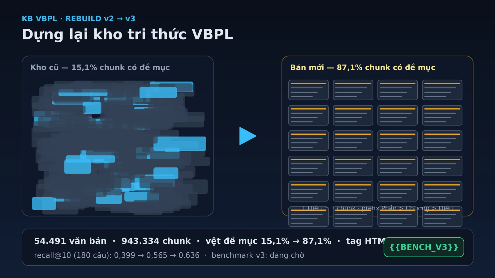

Con số khiến tôi quyết định dựng lại cả kho tri thức VBPL là 15,1%. Trong hơn 637.000 chunk của kho cũ, chỉ 15,1% biết mình nằm ở Điều nào, Chương nào. Phần còn lại là những đoạn văn trôi tự do. Khi hệ thống trích nguồn "Điều 5, Nghị định 356/2025" cho một câu trả lời, chính đoạn được trích cũng không mang thông tin này, nên tôi không có cách nào kiểm tra lại.

Nói rõ hai từ sẽ lặp nhiều trong bài. Chunking là việc chia nhỏ văn bản thành từng đoạn để truy xuất; mỗi đoạn đó gọi là chunk. Embedding là việc biến mỗi chunk thành một vector, để máy so sánh các đoạn với câu hỏi theo nghĩa chứ không chỉ theo từ khóa. Kho tri thức VBPL của tôi phục vụ việc hỏi đáp về văn bản quy phạm pháp luật Việt Nam, và chất lượng của nó phụ thuộc rất nhiều vào hai bước này.

Bài này kể hành trình dựng lại kho theo bốn mảng: chia chunk theo cấu trúc luật, chuyển HTML sang markdown kể cả bảng, cho pipeline chạy đều cả 12 lõi CPU, và đo bằng bộ 180 câu hỏi. Số liệu của bản v3 đang chờ bước nhúng vector chạy xong, nên ở những chỗ cần tôi để dấu `{{BENCH_V3}}` để điền sau.

<!-- truncate -->

## Kho cũ hỏng ở đâu

Kho cũ có 54.365 văn bản, cắt thành 637.814 chunk. Kiểm tra kỹ thì ra hai vấn đề.

Chỉ 15,1% chunk có vệt đề mục, tức là biết mình thuộc chuỗi Phần, Chương, Mục, Điều nào. Nguyên nhân khá ngớ ngẩn: bộ nhận đề mục cũ chỉ hiểu dấu `#` của markdown, trong khi văn bản luật ghi "Chương I", "Điều 5" ở những dòng chữ thường. Cả kho bị cắt theo độ dài, đề mục mất sạch.

Vấn đề còn lại: 17% chunk sót lại tag HTML như `
` hay `<table>`. Máy đọc những chunk này kiểu nuốt luôn vỏ bao bì, và một chunk chứa bảng mà mất cấu trúc bảng thì gần như vô dụng với câu hỏi về mức phạt hay số liệu.

Hệ quả của cả hai là một kiểu lỗi rất khó chịu: hệ thống tìm đúng văn bản, nhưng trượt đoạn chứa đáp án.

## Chia chunk theo Điều, không theo độ dài

Cách làm mới khá trực giác. Một bộ quy tắc nhận diện năm cấp cấu trúc của văn bản luật: Phần, Chương, Mục, Tiểu mục, Điều. Khoản và Điểm không tách riêng mà giữ bên trong chunk của Điều. Phụ lục là nhánh riêng. Mỗi chunk mở đầu bằng hai dòng: tên văn bản, rồi vệt đề mục đầy đủ như `## Phần thứ nhất > Chương I > Điều 5`.

Nếu một Điều ngắn, nó thành nguyên một chunk. Điều dài thì cắt tại ranh giới Khoản hoặc Điểm, rồi đến ranh giới câu. Không bao giờ cắt giữa câu.

Cái khó nằm ở chỗ chữ "Chương", "Điều" cũng xuất hiện trong câu văn thường, kiểu "theo quy định tại Chương II của Nghị định này". Bản cũ từng nhặt nhầm 12,84% chunk vì lý do này; riêng cụm "Chương II Nghị định này." từng bị coi là đề mục của 817 chunk. Nên lần này tôi thêm bộ lọc nghiêm ngặt cho phần chữ đứng sau số hiệu, rồi chạy thử trên 25 ca khó. Kết quả 25/25 nhận đúng, không nhặt nhầm ca nào.

Số liệu sau khi chạy thật. Trên mẫu 300 văn bản ngẫu nhiên, bản mới nhận được đề mục ở 71,3% văn bản, so với 6,0% của bản cũ. Trong nhóm 20 văn bản khó, gồm biểu mẫu, văn bản hợp nhất và cả văn bản thập niên 1950, tỉ lệ là 50% so với 27,8%. Và khi dựng toàn kho thành bản v2:

| | Kho cũ | Bản dựng v2 |
|---|---:|---:|
| Văn bản | 54.365 | 54.491 |
| Chunk | 637.814 | 943.334 |
| Chunk có vệt đề mục | 15,1% | 87,1% |
| Chunk còn tag HTML | 17,0% | 0,007% |

Số chunk tăng khoảng 48% so với kho cũ. Đó là đánh đổi có chủ đích: ưu tiên không cắt giữa Điều nên những Điều ngắn thành chunk riêng, thay vì bị gộp tự do. Chưa có đề mục cho 12,9% chunk còn lại, chủ yếu là biểu mẫu và văn bản cũ không cấu trúc, là việc để làm sau.

Trước khi dựng, tôi cũng đo xem cỡ chunk bao nhiêu là hợp lý, trên mẫu 900 văn bản. Một Điều trung vị dài 202 token, nhưng 10% dài nhất vượt quá 740. Với cỡ 512 token và phần trùng lặp 64 token giữa hai chunk kề nhau, 82,3% Điều nằm nguyên vẹn trong một chunk. Hạ xuống 384 thì mất 8,1 điểm. Nâng lên 640 chỉ thêm 5 điểm, mà chunk dài hơn làm giảm độ chính xác truy xuất với bộ nhúng đang dùng. Kết luận là giữ 512. Một hướng chưa làm: ghép hai ba Điều ngắn vào chung một chunk, mô phỏng cho thấy giảm được số chunk từ khoảng 474.000 xuống 297.000 mà vẫn giữ nguyên vẹn 100% Điều.

## Chuyển HTML sang markdown, kể cả bảng

Nguồn của kho là HTML từ portal, và bảng là phần khó nhất. Bộ chuyển mới chạy trước khi cắt chunk: bảng HTML thành bảng markdown, ô trộng hay ô trồi thì lặp nội dung cho đủ ô, dấu `|` trong nội dung được thoát, sau hàng đầu có dòng phân cách cột.

Ở đây tôi tự tạo ra một cạm bẫy rồi tự tránh được. Việc dọn các dòng chỉ toàn ký tự `|` rác rất cần cho văn bản cũ, nhưng nếu áp cho mọi thứ, nó sẽ phá nát bảng markdown vừa chuyển xong. Giải pháp là quy tắc dọn chỉ áp cho đoạn không còn tag HTML. Kết quả trên mẫu: 0 chunk còn sót tag, kể cả nhóm 20 văn bản khó. Riêng 10 văn bản có bảng, chuyển sạch cả 10, với những bảng dài 63 đến 115 dòng.

## Cho pipeline ăn đều cả 12 lõi

Có một bài học vận hành đáng giá hơn cả kỹ thuật. Bản build đầu tiên của v3 từng chạy với 94,5% tải dồn vào 1 trong 12 lõi CPU. Mười một lõi còn lại ngồi chơi trong khi job chạy hàng giờ. Từ 27/10 tôi đặt thành quy tắc cho cả đội: mọi job pipeline phải chạy đa tiến trình dàn đều các lõi, SQLite chỉ có một tiến trình ghi duy nhất, và phải đo nhiệt khi chạy.

Lần tối ưu đó cho ra kiến trúc khá gọn: các worker thuần CPU làm việc nặng, một tiến trình ghi duy nhất ghép lô 200 văn bản mỗi giao dịch. Tốc độ xử lý tăng từ 42,3 lên 58 văn bản một giây, tức nhanh hơn 1,37 lần. Quan trọng hơn tốc độ là tính đúng đắn: so sánh trên 500 văn bản, kết quả giống hệt bản tuần tự, từng chunk, từng đề mục, từng token.

Phần nhúng vector được xếp thành ba tầng chồng lên nhau: tách token cho lô kế trong khi GPU mã hóa lô hiện tại, và ghi dữ liệu chạy nền không chờ GPU. GPU từ 73-75 độ lên 83-84 độ và bận 99% thời gian. Thật ra tốc độ nhúng tổng thể gần như không đổi, khoảng 1,0 lần, vì GPU mới là điểm nghẽn thật. Cái có được là pipeline không chặn nhau nữa, và việc ghi không làm đứng máy nhúng.

Ba lỗi được bắt trong lúc phát triển, đều đã sửa và thử lại: lấy lô kế trước khi lô hiện tại ghi xong khiến chạy trùng 6.000 chunk trên một mốc 3.000; tokenize cả lô 2.000 chunk làm phần đệm phình theo câu dài nhất, chia lô con 16 thì hết; và một lần chạy thử ghi nhầm cờ hoàn thành vào kho thật, phải xoá ngay và tách cờ riêng cho môi trường thử.

## Đo bằng 180 câu, và chỗ kho còn yếu

Benchmark là bộ 180 câu hỏi chia sáu tầng: tình huống, diễn đạt lại, đa tài liệu, viết tắt và số hiệu, so sánh thay đổi, thuật ngữ. Một model chấm điểm ba chỉ số. Recall đo đoạn chứa đáp án có vào được ngữ cảnh hay không, ngưỡng tôi đặt là 0,80. Precision đo ngữ cảnh có nhiễu nhiều không, ngưỡng 0,80. Relevancy đo mức phù hợp, ngưỡng 0,40. Truy xuất kết hợp vector và BM25 với trọng số 0,75 và 0,25.

Kết quả của bản dựng v2: recall 0,636, precision 0,806, relevancy 0,426. Hai chỉ số sau đạt ngưỡng, recall thì chưa. Đây là lần chạy tốt nhất kể từ đầu dự án: 0,399 ở bản đầu, 0,565 ở lần giữa, giờ là 0,636. Chi phí cho model chấm điểm là 0,82 đô cho cả 180 câu.

Chia theo tầng thì thấy rõ kho mạnh yếu ở đâu:

| Tầng câu hỏi | Số câu | Recall | Precision | Relevancy |
|---|---:|---:|---:|---:|
| Diễn đạt lại | 36 | 0,726 | 0,840 | 0,470 |
| Tình huống | 72 | 0,674 | 0,840 | 0,446 |
| Viết tắt, số hiệu | 18 | 0,694 | 0,863 | 0,392 |
| So sánh thay đổi | 18 | 0,635 | 0,736 | 0,411 |
| Đa tài liệu | 27 | 0,478 | 0,690 | 0,356 |
| Thuật ngữ | 9 | 0,333 | 0,782 | 0,394 |

Nhưng con số nói nhiều nhất nằm ở chỗ khác. Có 158 trên 180 câu tìm đúng văn bản trong top 10, mà chỉ 83 câu có đúng đoạn chứa đáp án. Nghĩa là với 75 câu, hệ thống đứng đúng trước cửa văn bản rồi lại đi sai phòng. Khoảng cách nằm ở tầng chọn đoạn trong văn bản, chứ không phải tầng tìm văn bản.

Bản v3, với chuỗi build và nhúng chạy song song, chưa có số benchmark. Khi bước nhúng và chấm điểm xong, bảng so sánh sẽ là: `{{BENCH_V3}}`.

## Hướng đi tiếp

Ba hướng tôi muốn thử kế tiếp, xếp theo chi phí tăng dần.

Rerank trong văn bản. Đã từng đo trên kho cũ: xếp hạng lại các chunk trong mỗi văn bản tìm được, đưa đoạn chứa đáp án vào ngữ cảnh từ 40 lên 98 trên 178 câu. Chưa bật ở v2, và đây là khoản nợ kiểm chứng rõ ràng nhất vì nó không đụng kho, chỉ cần một lượt benchmark.

Cha con theo Điều. Giữ chunk hiện tại làm tầng con, thêm dữ liệu về Điều và Khoản cha, khi truy xuất trúng thì mở rộng về cha. Chỉ cần thêm metadata, không phải nhúng lại, và trúng đúng chỗ yếu: đáp án thường nằm trọn trong một Điều.

Nới dẫn chiếu lúc hỏi. Câu "khoản 3 Điều 60 của Luật này" chỉ có nghĩa khi thấy văn bản mẹ. Một bộ phân tách cú pháp dẫn chiếu tiếng Việt, chạy lúc người dùng hỏi và kéo thêm văn bản được dẫn, nhắm thẳng vào hai tầng yếu nhất là đa tài liệu và so sánh thay đổi.

Ba hướng này đều có căn cứ từ khảo sát kỹ thuật tôi làm cuối tháng 10, đối chiếu với các kết quả đã công bố như contextual retrieval của Anthropic, late chunking của Jina, hay bộ đánh giá chiến lược chia chunk của Chroma. Điểm chung của chúng là không cần dựng lại kho, hợp với một проекта đang chạy.

## Kết

Hành trình v2 sang v3 chưa khép lại, vì số đo của v3 vẫn đang chờ. Nhưng có một thay đổi nhỏ tôi đã thấy rõ: 87,1% chunk giờ mở đầu bằng vệt đề mục của chính nó, nên khi hệ thống trích "Điều 5, Nghị định 356/2025", dòng chữ đó nằm ngay đầu đoạn được trích, sẵn có trong dữ liệu. Với một kho tri thức pháp luật, đó là kiểu tiến bộ đúng nghĩa: không khoe gì, chỉ kiểm chứng được.

## Tài liệu tham khảo

1. [Contextual Retrieval](https://www.anthropic.com/news/contextual-retrieval) — Anthropic, 2024.
2. [Evaluating Chunking Strategies for Retrieval](https://research.trychroma.com/evaluating-chunking) — Chroma, 2024.
3. [Late Chunking: Contextual Chunk Embeddings Using Long-Context Embedding Models](https://arxiv.org/abs/2409.04701) — Günther và cộng sự, 2024.
4. [ViHERMES: benchmark multihop QA trên văn bản pháp luật tiếng Việt](https://arxiv.org/abs/2602.07361) — ACIIDS 2026.
5. Số liệu nội bộ: các báo cáo T-309, T315, T316, T317, T322 của dự án KB VBPL, tháng 10/2026.

*Số liệu v3 sẽ được bổ sung vào chỗ `{{BENCH_V3}}` sau khi hoàn tất nhúng vector và chấm điểm.*
